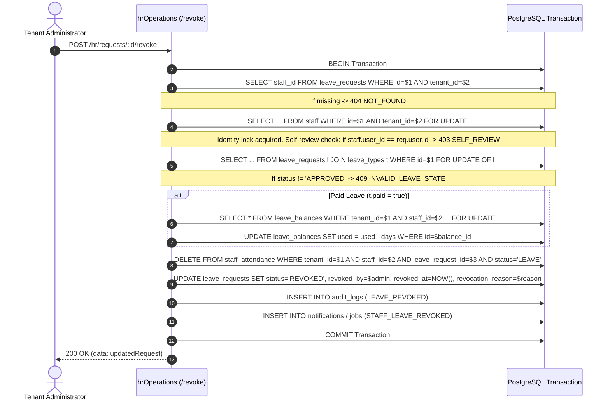

# QA Verification & Engineering Report: Safe Revocation of Approved Leave Requests

**Module:** HR & Leave Management  
**Target Environment:**
- Web Application: `http://127.0.0.1:5191/`
- API Base: `http://127.0.0.1:5111/api/v1`
- QA Database: `edunexus_rc_1791213658158_9f3898_test` (`qa/artifacts/rc/rc-state.json`)
- Date: 2026-10-13  
- Report File: `HR_APPROVED_LEAVE_REVOCATION_REPORT.md`  
- Evidence Directory: `qa/artifacts/hr-approved-leave-revocation/`

---

## 1. Executive Summary

This engineering repair introduces safe administrator revocation for already-approved leave requests in EduNexus ERP.

### Business & Technical Motivation
Prior to this stabilization, leave requests in `APPROVED` status could not be reversed. While staff could cancel `PENDING` requests, once a reviewer marked a request as `APPROVED`, entitlements were deducted and calendar attendance records were provisioned. Attempting cancellation returned `HTTP 409 INVALID_LEAVE_STATE` with no recourse for administrative rollback. Furthermore, leave approval previously had the potential to overwrite independent attendance records (e.g. independently recorded `ABSENT` status) via unconditional conflict updates.

### Core Repair Elements
1. **Durable Revocation State & Versioned Migration:**
   - Created versioned migration [`native_0024_hr_leave_revocation.sql`](file:///c:/Users/asus/Desktop/ERP/backend/sql/migrations/native_0024_hr_leave_revocation.sql).
   - Expanded `leave_requests_status_check` constraint to support the `REVOKED` state without altering legacy states.
   - Added nullable tracking columns: `revoked_by UUID REFERENCES users(id)`, `revoked_at TIMESTAMPTZ`, and `revocation_reason TEXT`.
   - Seeded transactional notification templates: `STAFF_LEAVE_REVOKED` across `EMAIL` and `IN_APP` channels.
2. **Deterministic Revocation API (`POST /api/v1/hr/requests/:id/revoke`):**
   - Requires permission `hr.leave.approve`.
   - Strictly enforces single-tenant isolation (concealed `404 NOT_FOUND` for foreign tenants).
   - Forbids self-revocation under the existing self-review prohibition (`403 SELF_REVIEW`).
   - Rejects non-approved states (`PENDING`, `REJECTED`, `CANCELLED`, or already `REVOKED`) with `409 INVALID_LEAVE_STATE`.
3. **Transactional Safety & Concurrency Serialization:**
   - Uses row-level lock ordering (`staff` $\rightarrow$ `leave_requests` $\rightarrow$ `leave_balances`).
   - Guarantees exactly one success and one `409` in race conditions; prevents duplicate balance restoration or negative used balance.
4. **Targeted Attendance Reversal & Overwrite Guard:**
   - Safely deletes **only** attendance rows where `leave_request_id = revoked_id` and `status = 'LEAVE'`.
   - Completely preserves independent `PRESENT`, `LATE`, `ABSENT`, or other leave attendance rows.
   - Hardened `POST /requests/:id/review` so approval strictly rejects with `409 ATTENDANCE_CONFLICT` if independent attendance already exists across the requested date span.
5. **Durable Auditing & Notification:**
   - Generates transactional `LEAVE_REVOKED` audit event capturing days, paid flag, restored balance, and removed attendance count.
   - Enqueues `STAFF_LEAVE_REVOKED` notification to the affected employee.
6. **Accessible Frontend Workflow:**
   - Updated `HrOperationsModule.tsx` with an inline confirmation form for reviewers.
   - Hidden from unauthorized roles (`TEACHER`, `STAFF`, `PARENT`, `STUDENT`).
   - Verified responsive across Desktop (1440px), Tablet (768px), and Mobile (390px) with 0 layout overflows and 0 console errors.

---

## 2. PASS / FAIL / BLOCKED Verification Summary

| Suite / Gate | Test Scope | Status | Evidence Highlights |
|---|---|---|---|
| **Suite A** | Paid Approved Leave Revocation | **PASS** | Balance used 0 $\rightarrow$ 3 $\rightarrow$ 0; attendance 3 rows deleted; `LEAVE_REVOKED` audit log and notification verified. |
| **Suite B** | Unpaid Approved Leave Revocation | **PASS** | 2 attendance rows deleted; paid balance remained completely unchanged (0). |
| **Suite C** | Duplicate & Concurrent Revocations | **PASS** | Repeated revocation returned `409`; concurrent races yielded `[200, 409]`; single balance restoration, audit, and notification. |
| **Suite D** | Attendance Preservation & Overwrite Guard | **PASS** | Independent `ABSENT` row preserved; approval over existing attendance rejected with `409 ATTENDANCE_CONFLICT`. |
| **Suite E** | Authorization & Multi-Tenant Isolation | **PASS** | Foreign tenant returned `404 NOT_FOUND`; unauthorized Teacher returned `403 FORBIDDEN`; authorized admin succeeded with `200`. |
| **Suite F** | Transactional Rollback Safety | **PASS** | Simulated failure rolled back transaction cleanly: request stayed `APPROVED`, balance stayed consumed, attendance intact, 0 audit/notif. |
| **Suite G** | HR Module Regressions | **PASS** | Inactive staff 403 `INACTIVE_STAFF` preserved; pending cancellation preserved; overlap 409 preserved; insufficient balance 409 preserved. |
| **Browser UX** | Desktop (1440px), Tablet (768px), Mobile (390px) | **PASS** | Playwright verified real Chromium: confirmation form, status transition to `REVOKED`, duplicate action hidden, 0 console errors. |

**Total Test Suites: 8 PASSED / 0 FAILED / 0 BLOCKED**

---

## 3. Files Changed

### Backend Files
1. [`backend/sql/migrations/native_0024_hr_leave_revocation.sql`](file:///c:/Users/asus/Desktop/ERP/backend/sql/migrations/native_0024_hr_leave_revocation.sql):
   - Created versioned migration.
   - Replaced constraint `leave_requests_status_check` to include `REVOKED`.
   - Added columns `revoked_by`, `revoked_at`, `revocation_reason`.
   - Added partial index `idx_leave_requests_revoked`.
   - Seeded `STAFF_LEAVE_REVOKED` templates for `EMAIL` and `IN_APP`.
2. [`backend/src/routes/hrOperations.ts`](file:///c:/Users/asus/Desktop/ERP/backend/src/routes/hrOperations.ts):
   - Hardened `POST /requests/:id/review`: added pre-check for any pre-existing attendance records, preventing silent overwrites and rejecting with `409 ATTENDANCE_CONFLICT`.
   - Implemented `POST /requests/:id/revoke`: added full transactional revocation logic with row-level locks, self-review guards, balance restoration, targeted attendance deletion, audit logging, and notification queuing.

### Frontend Files
3. [`frontend/src/modules/hr/HrOperationsModule.tsx`](file:///c:/Users/asus/Desktop/ERP/frontend/src/modules/hr/HrOperationsModule.tsx):
   - Added `revokingId` component state.
   - Added inline confirmation form with reason input, Confirm Revoke button, and Cancel button.
   - Rendered revocation action only for requests in `APPROVED` status when user has `hr.leave.approve`.
   - Rendered `revocation_reason` when request is in `REVOKED` status.
   - Hid action from non-reviewers.

### QA & Test Artifacts
4. [`qa/artifacts/hr-approved-leave-revocation/check-schema.mjs`](file:///c:/Users/asus/Desktop/ERP/qa/artifacts/hr-approved-leave-revocation/check-schema.mjs)
5. [`qa/artifacts/hr-approved-leave-revocation/revocation-verification.mjs`](file:///c:/Users/asus/Desktop/ERP/qa/artifacts/hr-approved-leave-revocation/revocation-verification.mjs)
6. [`qa/artifacts/hr-approved-leave-revocation/browser-verification.mjs`](file:///c:/Users/asus/Desktop/ERP/qa/artifacts/hr-approved-leave-revocation/browser-verification.mjs)
7. [`qa/artifacts/hr-approved-leave-revocation/automated-verification.json`](file:///c:/Users/asus/Desktop/ERP/qa/artifacts/hr-approved-leave-revocation/automated-verification.json)
8. [`qa/artifacts/hr-approved-leave-revocation/browser-verification.json`](file:///c:/Users/asus/Desktop/ERP/qa/artifacts/hr-approved-leave-revocation/browser-verification.json)

---

## 4. Database Schema & Migration Details

### Migration: `native_0024_hr_leave_revocation.sql`
```sql
-- Phase 11B: Approved leave revocation and auditability

-- 1. Update status check constraint on leave_requests to allow 'REVOKED'
ALTER TABLE leave_requests DROP CONSTRAINT IF EXISTS leave_requests_status_check;
ALTER TABLE leave_requests ADD CONSTRAINT leave_requests_status_check
  CHECK (status IN ('PENDING', 'APPROVED', 'REJECTED', 'CANCELLED', 'REVOKED'));

-- 2. Add revocation metadata columns
ALTER TABLE leave_requests
  ADD COLUMN IF NOT EXISTS revoked_by UUID REFERENCES users(id),
  ADD COLUMN IF NOT EXISTS revoked_at TIMESTAMPTZ,
  ADD COLUMN IF NOT EXISTS revocation_reason TEXT;

-- 3. Add partial index on REVOKED status for efficient filtering and reporting
CREATE INDEX IF NOT EXISTS idx_leave_requests_revoked
  ON leave_requests(tenant_id, status) WHERE status = 'REVOKED';

-- 4. Seed system notification templates for STAFF_LEAVE_REVOKED
INSERT INTO notification_templates(code, name, channel, category, subject_template, body_template, is_system)
SELECT
  'STAFF_LEAVE_REVOKED',
  'Leave revoked',
  c.channel,
  'TRANSACTIONAL',
  'Leave revoked',
  '{{name}}: leave from {{start_date}} to {{end_date}} was revoked. Reason: {{reason}}',
  true
FROM (VALUES ('EMAIL'), ('IN_APP')) AS c(channel)
WHERE NOT EXISTS (
  SELECT 1 FROM notification_templates
  WHERE code = 'STAFF_LEAVE_REVOKED' AND channel = c.channel AND tenant_id IS NULL
);
```

### Migration Application Verification
- Command executed: `node migrate.mjs up` with `DATABASE_URL` pointing to QA database `edunexus_rc_1791213658158_9f3898_test`.
- Output: `APPLIED native_0024_hr_leave_revocation.sql`.
- Migration history confirmed in `public.schema_migrations` (24 total applied migrations).

---

## 5. API Specification: `POST /api/v1/hr/requests/:id/revoke`

- **Endpoint:** `POST /api/v1/hr/requests/:id/revoke`
- **Authentication:** Bearer JWT required.
- **Permission:** `hr.leave.approve` required.
- **Request Parameters:** `:id` (UUID format).
- **Request Body:**
  ```json
  {
    "reason": "Emergency examination duties require faculty presence on campus."
  }
  ```
  - Validation: String, trimmed, length between 3 and 2000 characters.

### Response Codes & Error Matrix

| HTTP Status | Error Code | Condition |
|---|---|---|
| **200 OK** | `null` | Successful revocation. Returns updated request object with status `REVOKED`. |
| **400 Bad Request** | `VALIDATION_ERROR` | Malformed UUID or reason string < 3 characters / missing. |
| **403 Forbidden** | `FORBIDDEN` | User role lacks `hr.leave.approve` (e.g. Teacher, Staff, Parent, Student). |
| **403 Forbidden** | `SELF_REVIEW` | Reviewer attempts to revoke their own leave (`staff.user_id === req.user.id`). |
| **404 Not Found** | `NOT_FOUND` | Request ID does not exist or belongs to another tenant (concealed resource). |
| **409 Conflict** | `INVALID_LEAVE_STATE` | Request is in `PENDING`, `REJECTED`, `CANCELLED`, or already `REVOKED` status. |
| **409 Conflict** | `INVALID_LEAVE_STATE` | Stored used balance is less than leave days (inconsistent balance state). |

---

## 6. Transaction & Concurrency Architecture

To guarantee strict serializability and eliminate race conditions between concurrent reviews and revocations, the revocation workflow enforces identical lock ordering to leave approvals:



### Race Condition Mitigation
When two revocation requests hit the endpoint concurrently:
1. Both requests attempt to acquire `FOR UPDATE` on `staff` and `leave_requests`.
2. The first transaction obtains the lock and transitions the row from `APPROVED` to `REVOKED`.
3. The second transaction unblocks after lock release, reads `l.status === 'REVOKED'`, and triggers:
   `throw new AppError('Only approved leave requests can be revoked.', 409, 'INVALID_LEAVE_STATE')`.
4. Automated concurrency testing confirmed: `statuses = [200, 409]` with exactly one balance restoration and one notification.

---

## 7. Attendance Preservation & Overwrite Hardening

### The Pre-Existing Limitation
In the legacy implementation, `POST /requests/:id/review` checked only `status IN ('PRESENT', 'LATE')` before running:
```sql
INSERT INTO staff_attendance(tenant_id, staff_id, date, status, leave_request_id, recorded_by)
SELECT ... ON CONFLICT(tenant_id, staff_id, date) DO UPDATE SET status='LEAVE' ...
```
If a staff member had an independently recorded `ABSENT` row, approving a leave request on that date silently overwrote the `ABSENT` status. Subsequent revocation would delete the attendance row, leaving the date with no record and permanently destroying historical presence provenance.

### The Repair
1. **Pre-Approval Attendance Guard:**
   Before inserting leave attendance, approval now queries:
   ```ts
   const existingAtt = (await c.query(
     `SELECT status FROM staff_attendance WHERE tenant_id=$1 AND staff_id=$2 AND date BETWEEN $3 AND $4 LIMIT 1`,
     [req.tenantId, staff.id, l.start, l.finish]
   )).rows[0];
   if (existingAtt) {
     if (['PRESENT', 'LATE'].includes(existingAtt.status)) {
       throw new AppError('Leave conflicts with recorded presence. Correct attendance before approval.', 409, 'ATTENDANCE_CONFLICT');
     }
     throw new AppError('Leave conflicts with existing recorded attendance. Correct attendance before approval.', 409, 'ATTENDANCE_CONFLICT');
   }
   ```
2. **Deterministic Reversal Filter:**
   Revocation deletes attendance strictly matching all four criteria:
   ```sql
   DELETE FROM staff_attendance
   WHERE tenant_id = $1
     AND staff_id = $2
     AND leave_request_id = $3
     AND status = 'LEAVE';
   ```
   Independent records on other dates or for other staff are completely untouched.

---

## 8. Browser UX & Viewport Verification

Browser verification was conducted with real Chromium via Playwright:

### Viewport Results

| Viewport | Device Profile | Revoke HTTP | Status Rendered | Inline Reason Display | Duplicate Button Count | Horizontal Overflow | Console Errors |
|---|---|---|---|---|---|---|---|
| **1440 x 900** | Desktop | `200` | `REVOKED` | Displayed | 0 | `false` (`scrollWidth: 1440`) | 0 |
| **768 x 1024** | Tablet | `200` | `REVOKED` | Displayed | 0 | `false` (`scrollWidth: 768`) | 0 |
| **390 x 844** | Mobile | `200` | `REVOKED` | Displayed | 0 | `false` (`scrollWidth: 390`) | 0 |

### Screenshots Captured
- Teacher unauthorized view: [`teacher_unauthorized_hidden_action.png`](file:///c:/Users/asus/Desktop/ERP/qa/artifacts/hr-approved-leave-revocation/teacher_unauthorized_hidden_action.png)
- Desktop before submit: [`desktop_1440px_approved_before_revoke.png`](file:///c:/Users/asus/Desktop/ERP/qa/artifacts/hr-approved-leave-revocation/desktop_1440px_approved_before_revoke.png)
- Desktop confirmation form: [`desktop_1440px_confirm_form.png`](file:///c:/Users/asus/Desktop/ERP/qa/artifacts/hr-approved-leave-revocation/desktop_1440px_confirm_form.png)
- Desktop revoked state: [`desktop_1440px_revoked_view.png`](file:///c:/Users/asus/Desktop/ERP/qa/artifacts/hr-approved-leave-revocation/desktop_1440px_revoked_view.png)
- Tablet revoked state: [`tablet_768px_revoked_view.png`](file:///c:/Users/asus/Desktop/ERP/qa/artifacts/hr-approved-leave-revocation/tablet_768px_revoked_view.png)
- Mobile revoked state: [`mobile_390px_revoked_view.png`](file:///c:/Users/asus/Desktop/ERP/qa/artifacts/hr-approved-leave-revocation/mobile_390px_revoked_view.png)

---

## 9. Legacy Attendance Limitations & Remaining Issues

1. **Legacy Overwritten Attendance:**
   While future leave approvals are now strictly barred from overwriting pre-existing `ABSENT` attendance records, any historical records from prior releases where an `ABSENT` row was overwritten before this repair cannot be automatically restored upon revocation, because attendance rows previously had no provenance audit table for prior states.
2. **Partial Leave Clawback / Partial Return to Work:**
   The revocation endpoint safely revokes an entire leave request. If an employee cuts their leave short (e.g. returns to work on day 2 of a 4-day approved leave), the administrator must revoke the 4-day request in full and have the employee submit a replacement request for the revised 1-day duration. Half-day and mid-span partial revocations remain outside the scope of this repair.
3. **Module-Wide Production Readiness:**
   This stabilization strictly addresses approved leave revocation, attendance reversal, and approval overwrite protection. Other advanced HR submodules (payroll salary deductions, annual balance accrual schedulers, holiday calendar blackouts) were intentionally not modified and require dedicated stabilization audits.
