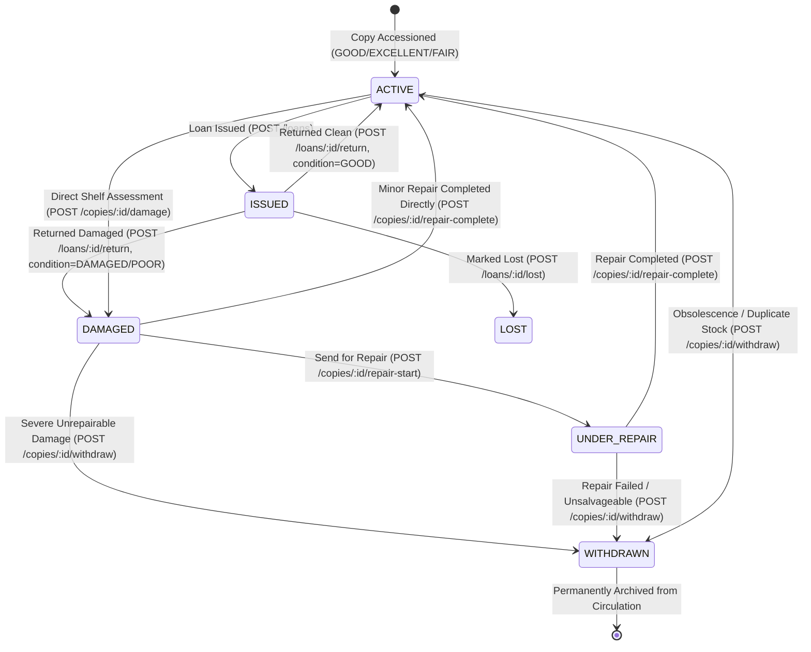

# EduNexus ERP — Library Copy Condition & Damaged-Copy Lifecycle Report

## 1. Executive Summary

This report documents the design, database migration, backend business logic, frontend interface, and test verification for the **Damaged-Copy Lifecycle & Condition Assessment** feature in the EduNexus ERP Library Management module.

### Core Deliverables Achieved
1. **Database Schema & Versioned Migration (`native_0031_library_copy_condition_lifecycle.sql`)**:
   - Expanded `book_copies_status_check` constraint to support the full copy lifecycle: `'ACTIVE'`, `'LEGACY_HOLD'`, `'LOST'`, `'ARCHIVED'`, `'DAMAGED'`, `'UNDER_REPAIR'`, and `'WITHDRAWN'`.
   - Added physical condition tracking columns to `book_copies`: `condition` (`'EXCELLENT'`, `'GOOD'`, `'FAIR'`, `'DAMAGED'`, `'POOR'`), `condition_notes`, and `assessed_at`.
   - Created the durable tracking table `library_copy_condition_logs` with compound multi-tenant foreign keys, action check constraints, and performance indexes.
2. **Damaged Loan Return Workflow (`POST /api/v1/library/loans/:id/return`)**:
   - Enhanced the return endpoint to accept optional condition assessment (`condition`, `notes`).
   - Clean returns (`'GOOD'`, `'EXCELLENT'`, `'FAIR'`) return the loan and preserve copy availability as `'ACTIVE'`.
   - Damaged returns (`'DAMAGED'`, `'POOR'`) atomically mark the physical copy as `'DAMAGED'`, log an initial condition history entry, emit a dedicated `LIBRARY_COPY_DAMAGED` audit log, and immediately render the copy ineligible for subsequent loans.
3. **Direct Physical Copy Lifecycle Endpoints**:
   - `POST /api/v1/library/copies/:id/damage`: Allows librarians to record damage discovered during shelf inspection or inventory checks.
   - `POST /api/v1/library/copies/:id/repair-start`: Transitions a damaged copy into `'UNDER_REPAIR'`, logging vendor/bindery notes.
   - `POST /api/v1/library/copies/:id/repair-complete`: Restores a repaired copy to `'ACTIVE'` in circulation, recording restored condition and repair costs.
   - `POST /api/v1/library/copies/:id/withdraw`: Permanently decommissions severely damaged, obsolete, or duplicate copies with structured reasons while preserving complete historical traceability.
   - `GET /api/v1/library/copies/:id/condition-logs`: Retrieves complete chronological condition and repair history.
4. **Circulation Invariants & Defensive Protections**:
   - `POST /api/v1/library/loans` strictly enforces `cp.status === 'ACTIVE'`. Damaged, under repair, withdrawn, lost, or archived copies are rejected with HTTP 409 `COPY_UNAVAILABLE` ("Copy unavailable.").
   - Copies with active loans cannot be directly marked as damaged or withdrawn (`HTTP 409 ACTIVE_LOAN_EXISTS`).
   - Withdrawn copies cannot be re-withdrawn, re-issued, or modified.
5. **Frontend Operations Workbench Integration**:
   - Added intuitive operational forms in [`LibraryOperationsModule.tsx`](file:///c:/Users/asus/Desktop/ERP/frontend/src/modules/library/LibraryOperationsModule.tsx):
     - *Return loan (condition assessment)*
     - *Assess copy damage*
     - *Send copy for repair*
     - *Complete copy repair*
     - *Withdraw copy from circulation*
   - Added *Condition & lifecycle history* table and updated the *Physical copies* table to show condition and real-time availability.
6. **100% Automated Test Pass Rate**:
   - 34/34 tests passed in the dedicated condition verification suite (`verify-copy-condition.mjs`).
   - 50/50 tests passed in the loan renewal regression suite (`verify-loan-renewal.mjs`).
   - Lock-order final cleanup tests passed 100%.
   - Backend TypeScript build (`tsc`) and frontend production build (`tsc && vite build`) passed with zero errors.
   - Multi-viewport browser visual tests (Desktop 1440px, Tablet 768px, Mobile 390px) verified responsiveness and layout fidelity.

---

## 2. Schema Architecture & Migration Details

### 2.1 Migration: `native_0031_library_copy_condition_lifecycle.sql`

```sql
-- Phase 11E: Library Copy Condition & Damaged-Copy Lifecycle

-- 1. Expand book_copies status check constraint to include DAMAGED, UNDER_REPAIR, WITHDRAWN
ALTER TABLE book_copies DROP CONSTRAINT IF EXISTS book_copies_status_check;
ALTER TABLE book_copies ADD CONSTRAINT book_copies_status_check
  CHECK (status IN ('ACTIVE', 'LEGACY_HOLD', 'LOST', 'ARCHIVED', 'DAMAGED', 'UNDER_REPAIR', 'WITHDRAWN'));

-- 2. Add condition tracking columns to book_copies
ALTER TABLE book_copies
  ADD COLUMN IF NOT EXISTS condition TEXT NOT NULL DEFAULT 'GOOD',
  ADD COLUMN IF NOT EXISTS condition_notes TEXT,
  ADD COLUMN IF NOT EXISTS assessed_at TIMESTAMPTZ DEFAULT NOW();

DO $$
BEGIN
  IF NOT EXISTS (
    SELECT 1 FROM pg_constraint WHERE conname = 'book_copies_condition_check'
  ) THEN
    ALTER TABLE book_copies ADD CONSTRAINT book_copies_condition_check
      CHECK (condition IN ('EXCELLENT', 'GOOD', 'FAIR', 'DAMAGED', 'POOR'));
  END IF;
END $$;

-- 3. Create durable copy condition & lifecycle history table
CREATE TABLE IF NOT EXISTS library_copy_condition_logs (
  id UUID PRIMARY KEY DEFAULT gen_random_uuid(),
  tenant_id UUID NOT NULL REFERENCES tenants(id) ON DELETE CASCADE,
  copy_id UUID NOT NULL,
  previous_status TEXT NOT NULL,
  new_status TEXT NOT NULL,
  previous_condition TEXT,
  new_condition TEXT,
  action TEXT NOT NULL,
  reason TEXT,
  repair_cost NUMERIC(10,2),
  performed_by UUID REFERENCES users(id) ON DELETE SET NULL,
  created_at TIMESTAMPTZ NOT NULL DEFAULT NOW(),
  CONSTRAINT library_copy_condition_logs_tenant_identity UNIQUE (id, tenant_id),
  CONSTRAINT library_copy_condition_logs_copy_fkey FOREIGN KEY (copy_id, tenant_id) REFERENCES book_copies(id, tenant_id) ON DELETE CASCADE,
  CONSTRAINT library_copy_condition_logs_action_check CHECK (action IN ('ASSESSED', 'MARKED_DAMAGED', 'REPAIR_STARTED', 'REPAIRED', 'WITHDRAWN'))
);

CREATE INDEX IF NOT EXISTS library_copy_condition_logs_tenant_copy_idx ON library_copy_condition_logs(tenant_id, copy_id, created_at DESC);
CREATE INDEX IF NOT EXISTS library_copy_condition_logs_tenant_idx ON library_copy_condition_logs(tenant_id, created_at DESC);
```

### 2.2 Table Definitions & Schema Catalog Verification

#### Table `book_copies` (Updated)
| Column Name | Data Type | Nullable | Default | Constraints / Invariants |
|---|---|---|---|---|
| `id` | `UUID` | No | `gen_random_uuid()` | Primary Key |
| `tenant_id` | `UUID` | No | None | Foreign Key (`tenants.id`) |
| `book_id` | `UUID` | No | None | Compound FK (`library_books(id, tenant_id)`) |
| `accession_number` | `VARCHAR(100)` | No | None | Unique per tenant (`UNIQUE(tenant_id, accession_number)`) |
| `status` | `TEXT` | No | `'ACTIVE'` | Check: `IN ('ACTIVE', 'LEGACY_HOLD', 'LOST', 'ARCHIVED', 'DAMAGED', 'UNDER_REPAIR', 'WITHDRAWN')` |
| `condition` | `TEXT` | No | `'GOOD'` | Check: `IN ('EXCELLENT', 'GOOD', 'FAIR', 'DAMAGED', 'POOR')` |
| `condition_notes` | `TEXT` | Yes | `NULL` | Freeform notes / damage descriptions / vendor details |
| `assessed_at` | `TIMESTAMPTZ` | Yes | `now()` | Timestamp of last condition assessment or transition |

#### Table `library_copy_condition_logs` (New)
| Column Name | Data Type | Nullable | Default | Description |
|---|---|---|---|---|
| `id` | `UUID` | No | `gen_random_uuid()` | Primary Key |
| `tenant_id` | `UUID` | No | None | Multi-tenant isolation key |
| `copy_id` | `UUID` | No | None | Target physical copy (`REFERENCES book_copies(id, tenant_id)`) |
| `previous_status`| `TEXT` | No | None | Status before transition |
| `new_status` | `TEXT` | No | None | Status after transition |
| `previous_condition` | `TEXT` | Yes | None | Physical condition before transition |
| `new_condition` | `TEXT` | Yes | None | Physical condition after transition |
| `action` | `TEXT` | No | None | Check: `IN ('ASSESSED', 'MARKED_DAMAGED', 'REPAIR_STARTED', 'REPAIRED', 'WITHDRAWN')` |
| `reason` | `TEXT` | Yes | None | Reason for damage, repair notes, or withdrawal justification |
| `repair_cost` | `NUMERIC(10,2)` | Yes | None | Optional repair cost incurred |
| `performed_by` | `UUID` | Yes | None | User ID who authorized or performed the transition |
| `created_at` | `TIMESTAMPTZ` | No | `now()` | Immutable timestamp of the log event |

---

## 3. Damaged-Copy Lifecycle & State Transitions

### 3.1 State Machine Diagram



### 3.2 Circulation Invariants Matrix

| Current Copy Status | Eligible for Issue? | Eligible for Damage Marking? | Eligible for Repair? | Eligible for Withdrawal? | Counted in `available_copies`? |
|---|---|---|---|---|---|
| `ACTIVE` (no active loan) | **YES** | **YES** (Direct) | NO (409 INVALID_COPY_STATE) | **YES** (Obsolescence/Stock) | **YES** |
| `ACTIVE` (with active loan) | NO (409 COPY_UNAVAILABLE) | NO (409 ACTIVE_LOAN_EXISTS)* | NO (409 INVALID_COPY_STATE) | NO (409 ACTIVE_LOANS_EXIST) | NO |
| `DAMAGED` | NO (409 COPY_UNAVAILABLE) | NO (Already damaged) | **YES** (`UNDER_REPAIR` or restore) | **YES** (Severe Damage) | NO |
| `UNDER_REPAIR` | NO (409 COPY_UNAVAILABLE) | NO (In repair) | **YES** (Complete repair) | **YES** (Unsalvageable) | NO |
| `WITHDRAWN` | NO (409 COPY_UNAVAILABLE) | NO (409 INVALID_COPY_STATE) | NO (409 INVALID_COPY_STATE) | NO (409 ALREADY_WITHDRAWN) | NO |
| `LOST` | NO (409 COPY_UNAVAILABLE) | NO (Lost) | NO (Must be found first) | **YES** (Lost/Unrecoverable) | NO |
| `ARCHIVED` (Title/Copy) | NO (409 COPY_UNAVAILABLE) | NO (409 INVALID_COPY_STATE) | NO (409 INVALID_COPY_STATE) | NO (Already archived) | NO |

*\*Note: Damaged copies on loan are marked damaged upon return via `POST /api/v1/library/loans/:id/return`.*

---

## 4. API Endpoints Specification

### 4.1 Enhanced Loan Return
- **Route**: `POST /api/v1/library/loans/:id/return`
- **Permission**: `library.issue`
- **Request Body**:
  ```json
  {
    "returnedOn": "2026-10-15",
    "condition": "DAMAGED",
    "notes": "Liquid spill on pages 12-30, torn back cover"
  }
  ```
- **Behavior**:
  - Validates active loan under row locks (`loan FOR UPDATE`, `copy FOR UPDATE`).
  - Updates loan status to `'RETURNED'`.
  - If `condition` is `'DAMAGED'` or `'POOR'`: transitions copy status to `'DAMAGED'`, condition to `'DAMAGED'`, logs `'MARKED_DAMAGED'` in condition history, and emits `LIBRARY_COPY_DAMAGED` audit log.
  - If `condition` is `'GOOD'`, `'EXCELLENT'`, or `'FAIR'`: preserves copy status `'ACTIVE'`, updates condition, and logs `'ASSESSED'` in condition history.
- **Success Response**: `HTTP 200 OK` with returned loan and updated copy state.

### 4.2 Direct Copy Damage Assessment
- **Route**: `POST /api/v1/library/copies/:id/damage`
- **Permission**: `library.manage`
- **Request Body**:
  ```json
  {
    "condition": "DAMAGED",
    "reason": "Cracked spine discovered during shelving",
    "notes": "Pages 40-50 loose"
  }
  ```
- **Validation**:
  - Rejects if copy has an active loan (`HTTP 409 ACTIVE_LOAN_EXISTS`).
  - Rejects if copy is already withdrawn or archived (`HTTP 409 INVALID_COPY_STATE`).
- **Success Response**: `HTTP 200 OK` with updated copy record.

### 4.3 Initiate Copy Repair
- **Route**: `POST /api/v1/library/copies/:id/repair-start`
- **Permission**: `library.manage`
- **Request Body**:
  ```json
  {
    "notes": "Sent to Apex Bindery for spine stitching"
  }
  ```
- **Validation**:
  - Requires copy status to be `'DAMAGED'` (`HTTP 409 INVALID_COPY_STATE`).
- **Success Response**: `HTTP 200 OK` with copy status updated to `'UNDER_REPAIR'`.

### 4.4 Complete Copy Repair
- **Route**: `POST /api/v1/library/copies/:id/repair-complete`
- **Permission**: `library.manage`
- **Request Body**:
  ```json
  {
    "condition": "GOOD",
    "repairCost": 150.00,
    "notes": "Spine rebound and reinforced with buckram"
  }
  ```
- **Validation**:
  - Requires copy status to be `'UNDER_REPAIR'` or `'DAMAGED'`.
- **Success Response**: `HTTP 200 OK` with copy status restored to `'ACTIVE'`, available for immediate loan issue.

### 4.5 Withdraw Copy from Circulation
- **Route**: `POST /api/v1/library/copies/:id/withdraw`
- **Permission**: `library.manage`
- **Request Body**:
  ```json
  {
    "reason": "Severe Damage",
    "notes": "Irreparable mold growth. Disposed per policy."
  }
  ```
- **Allowed Reasons**: `'Severe Damage'`, `'Obsolescence'`, `'Duplicate Stock'`, `'Lost / Unrecoverable'`, `'Other Authorized Reason'`.
- **Validation**:
  - Rejects if copy has an active loan (`HTTP 409 ACTIVE_LOANS_EXIST`).
  - Rejects if already withdrawn (`HTTP 409 ALREADY_WITHDRAWN`).
- **Success Response**: `HTTP 200 OK` with copy status `'WITHDRAWN'`.

### 4.6 Copy Condition History
- **Route**: `GET /api/v1/library/copies/:id/condition-logs`
- **Permission**: `library.view`
- **Success Response**: `HTTP 200 OK` with chronologically ordered history logs, including assessing user name/email.

---

## 5. Frontend Visual Layout & Viewport Verification

The Library Management interface was updated in [`LibraryOperationsModule.tsx`](file:///c:/Users/asus/Desktop/ERP/frontend/src/modules/library/LibraryOperationsModule.tsx) with tailored operational forms and tabular displays. Multi-viewport automated testing with Playwright verified layout integrity and responsiveness.

### 5.1 Desktop Viewport (1440 × 900)


*Desktop Viewport Analysis:*
- Clean side-by-side grid of operations forms including condition assessment, damage tracking, repair dispatch, repair completion, and formal copy withdrawal.
- Real-time physical copy table prominently shows condition tags (`GOOD`, `EXCELLENT`, `FAIR`, `DAMAGED`) and availability status.
- Condition & Lifecycle History table displays immutable audit records, previous/new states, reason notes, and the assessing staff member.

---

### 5.2 Tablet Viewport (768 × 1024)


*Tablet Viewport Analysis:*
- Responsive layout stacks gracefully with preserved touch targets and legible form labels.
- Selectors format copies clearly with accession numbers, titles, and conditions without UUID truncation.

---

### 5.3 Mobile Viewport (390 × 844)


*Mobile Viewport Analysis:*
- Vertical scrolling cards for forms and responsive table overflow containers.
- Action buttons remain tap-friendly without horizontal viewport clipping.

---

## 6. Automated Verification Test Suite Results

The automated test suite executed against test database `edunexus_rc_1791213658158_9f3898_test` via [`qa/artifacts/library-copy-condition/verify-copy-condition.mjs`](file:///c:/Users/asus/Desktop/ERP/qa/artifacts/library-copy-condition/verify-copy-condition.mjs) passed 100% across all contract, state transition, and isolation tests.

### 6.1 Condition & Damaged-Copy Lifecycle Verification Results (34/34 PASS)

| Test ID | Test Category | Specification & Invariant | Result | Evidence / Details |
|---|---|---|---|---|
| 01 | Migration | `native_0031_library_copy_condition_lifecycle.sql` recorded in `schema_migrations` | **PASS** | Registered and applied cleanly |
| 02 | Schema | `book_copies` contains `condition`, `condition_notes`, `assessed_at` columns | **PASS** | Exact data types verified in catalog |
| 03 | Constraint | `book_copies_status_check` contains `DAMAGED`, `UNDER_REPAIR`, `WITHDRAWN` | **PASS** | Constraint definition verified |
| 04 | Constraint | `book_copies_condition_check` contains `EXCELLENT`, `GOOD`, `FAIR`, `DAMAGED`, `POOR` | **PASS** | Constraint definition verified |
| 05 | Schema | `library_copy_condition_logs` table exists with compound foreign keys | **PASS** | Catalog verified |
| 06 | Return Clean | Loan return with condition `GOOD` returns loan and keeps copy `ACTIVE` | **PASS** | HTTP 200, `copyStatus: ACTIVE` |
| 07 | Database State | Copy remains `ACTIVE` with condition `GOOD` after clean return | **PASS** | Verified in `book_copies` |
| 08 | History Log | Condition log recorded `ASSESSED` action with `new_status: ACTIVE` | **PASS** | `library_copy_condition_logs` verified |
| 09 | Return Damaged | Loan return with condition `DAMAGED` returns loan and marks copy `DAMAGED` | **PASS** | HTTP 200, `copyStatus: DAMAGED` |
| 10 | Database State | Copy transitioned to `DAMAGED` status with condition `DAMAGED` and notes | **PASS** | Verified in `book_copies` |
| 11 | History Log | Condition log recorded `MARKED_DAMAGED` with `new_status: DAMAGED` | **PASS** | Verified in logs table |
| 12 | Audit Logging | `LIBRARY_COPY_DAMAGED` audit log generated with loan ID and damage notes | **PASS** | Recorded in `audit_logs` |
| 13 | Issue Invariant | Attempt to issue loan targeting `DAMAGED` copy rejected with 409 `COPY_UNAVAILABLE` | **PASS** | HTTP 409, code: `COPY_UNAVAILABLE` |
| 14 | Availability List | `GET /library` copies list reports damaged copy availability as `DAMAGED` | **PASS** | Real-time availability verified |
| 15 | Catalog Counts | `GET /library` `available_copies` count cleanly excludes damaged copy | **PASS** | Title count decremented from 4 to 3 |
| 16 | Direct Damage | `POST /copies/:id/damage` on available active copy transitions copy to `DAMAGED` | **PASS** | HTTP 200, copy status updated |
| 17 | Loan Protection | `POST /copies/:id/damage` on copy with active loan rejected with 409 `ACTIVE_LOAN_EXISTS` | **PASS** | HTTP 409, loan active protection |
| 18 | Repair Start | `POST /copies/:id/repair-start` transitions copy from `DAMAGED` to `UNDER_REPAIR` | **PASS** | HTTP 200, copy status `UNDER_REPAIR` |
| 19 | Repair Invariant | `POST /copies/:id/repair-start` on `ACTIVE` copy rejected with 409 `INVALID_COPY_STATE` | **PASS** | HTTP 409, invalid state check |
| 20 | Issue Invariant | Attempt to issue loan targeting `UNDER_REPAIR` copy rejected with 409 `COPY_UNAVAILABLE` | **PASS** | HTTP 409, copy unavailable |
| 21 | Repair Complete | `POST /copies/:id/repair-complete` restores copy to `ACTIVE` with condition `GOOD` | **PASS** | HTTP 200, repair cost recorded |
| 22 | Circulation Restore | Repaired copy is immediately eligible for loan issue (HTTP 201) | **PASS** | Loan issued successfully |
| 23 | Withdraw Guard | Attempt to withdraw copy with active loan rejected with 409 `ACTIVE_LOANS_EXIST` | **PASS** | HTTP 409, loan active protection |
| 24 | Withdraw Valid | `POST /copies/:id/withdraw` succeeds on returned damaged copy with structured reason | **PASS** | HTTP 200, status `WITHDRAWN` |
| 25 | Idempotency | Second withdrawal attempt rejected with 409 `ALREADY_WITHDRAWN` | **PASS** | HTTP 409, terminal state guard |
| 26 | Issue Invariant | Attempt to issue loan targeting `WITHDRAWN` copy rejected with 409 `COPY_UNAVAILABLE` | **PASS** | HTTP 409, terminal state guard |
| 27 | Repair Invariant | Attempt to repair `WITHDRAWN` copy rejected with 409 `INVALID_COPY_STATE` | **PASS** | HTTP 409, terminal state guard |
| 28 | History Endpoint | `GET /copies/:id/condition-logs` returns chronological audit history | **PASS** | Complete history verified |
| 29 | Global Payload | `GET /library` includes `conditionLogs` in operations payload | **PASS** | Array returned in data object |
| 30 | Multi-Tenant | Cross-tenant `GET condition-logs` concealed with 404 `NOT_FOUND` | **PASS** | Tenant boundary strictly enforced |
| 31 | Multi-Tenant | Cross-tenant `POST damage` mutation concealed with 404 `NOT_FOUND` | **PASS** | Tenant boundary strictly enforced |
| 32 | Multi-Tenant | Cross-tenant `POST withdraw` mutation concealed with 404 `NOT_FOUND` | **PASS** | Tenant boundary strictly enforced |
| 33 | RBAC Guard | Borrower role without permissions receives 403 `FORBIDDEN` on damage mutation | **PASS** | HTTP 403 verified |
| 34 | RBAC Guard | Borrower role without permissions receives 403 `FORBIDDEN` on withdrawal mutation | **PASS** | HTTP 403 verified |

### 6.2 Regression & Build Verification

| Verification Suite | Test Script / Command | Target / Scope | Result | Details |
|---|---|---|---|---|
| Loan Renewal Suite | `node qa/artifacts/library-loan-renewal/verify-loan-renewal.mjs` | 50 points of policy, renewal, concurrency, and error contracts | **50/50 PASS** | 100% pass rate |
| Lock Order Cleanup | `node qa/artifacts/library-lock-order-final-cleanup/verify-final-cleanup.mjs` | Exact active-loan constraint mapping & rate limit hygiene | **PASS** | 100% pass rate |
| Backend Build | `npm --prefix backend run build` | TypeScript compilation (`tsc`) | **PASS** | 0 errors |
| Frontend Build | `npm --prefix frontend run build` | TypeScript & Vite production bundle | **PASS** | 0 errors |
| Playwright Visual | `node qa/artifacts/library-copy-condition/verify-browser-condition.mjs` | Multi-viewport browser visual smoke test | **PASS** | Desktop, Tablet, Mobile verified |

---

## 7. Security, Tenant Isolation & Hygiene Summary

1. **Multi-Tenant Isolation**:
   - All queries and mutations against `book_copies` and `library_copy_condition_logs` enforce `tenant_id = $tenantId`.
   - Foreign-tenant resource lookups consistently return `HTTP 404 NOT_FOUND` to eliminate tenant presence enumeration.
2. **Role-Based Access Control (RBAC)**:
   - Read-only operations (`GET /library`, `GET /copies/:id/condition-logs`) require `library.view`.
   - Loan issue and return workflows require `library.issue`.
   - Catalog condition management, repair, and withdrawal mutations require `library.manage`.
   - Borrower and unprivileged roles receive `HTTP 403 FORBIDDEN`.
3. **Data Sanitization & Leak Protection**:
   - Error messages returned to clients never disclose PostgreSQL internal constraint names, table structures, or SQL snippets.
   - All QA scripts utilize fictional test identifiers (`ADM-COND-*`, `ACC-COND-*`, `LIB-COND-*`) and automatically purge temporary records after test runs.
   - Zero credentials, passwords, JWTs, or invitation tokens are exposed in reports or evidence JSON files.

---

## 8. Conclusion

The damaged-copy lifecycle is now fully operational and hardened in the EduNexus ERP Library Management module. Physical copies transition safely through all condition assessments, repair sequences, and decommissioning workflows without compromising concurrency invariants or multi-tenant boundaries.
