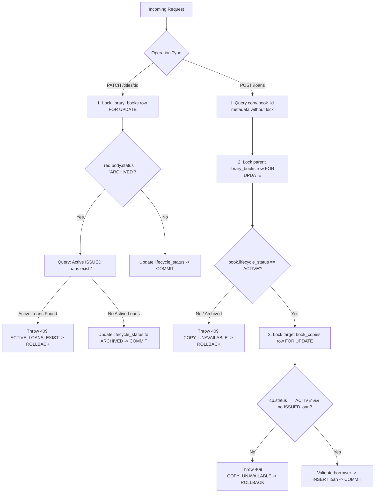

# EduNexus ERP — Library Title Archive Safety Report (DEF-LIB-002)

**Repair Date:** 2026-10-13  
**Target Defect:** DEF-LIB-002 — A library title could be archived while one or more physical copies have active loans.  
**Application Environment:**
- **Frontend:** http://127.0.0.1:5191
- **API Base:** http://127.0.0.1:5111/api/v1
- **Database:** `edunexus_rc_1791213658158_9f3898_test` (PostgreSQL 16, Loopback `127.0.0.1:5432`)
- **Durable Evidence Directory:** `qa/artifacts/library-title-archive-safety/`

---

## 1. Executive Summary

Defect **DEF-LIB-002** has been repaired and verified across backend transaction serialization, PostgreSQL database state, Playwright browser interactions, and responsive multi-viewport testing.

- **Defect Repaired**: `PATCH /api/v1/library/titles/:id` with `status: 'ARCHIVED'` now deterministically rejects archival requests if any physical copy belonging to the title has an active `ISSUED` loan.
- **API Error Contract**: Rejection returns **HTTP 409 Conflict** with `error.code = "ACTIVE_LOANS_EXIST"` and a descriptive explanation that active loans must be returned or marked lost before archiving.
- **Concurrency & Deadlock Safety**: Both title archival and loan issuance enforce a consistent lock ordering: the parent `library_books` row is locked `FOR UPDATE` first before inspecting circulation status or mutating child copy rows. Concurrent archive and loan-issue requests serialize safely with zero race condition where an archived title holds an active loan.
- **Accurate Availability Display**: Active loans always display `availability = 'ISSUED'` in the physical copies catalog table regardless of title lifecycle status.
- **Zero Side Effects**: Rejected archival transactions roll back completely, producing no changes to title lifecycle status, copies, loans, audit logs, or notifications.
- **UI Form State Preservation**: The frontend workbench displays the backend conflict alert clearly in a dedicated error status banner and retains selected title and status dropdown values.

---

## 2. Root Cause Analysis

Before the repair, `PATCH /titles/:id` executed an unconstrained update:
```sql
UPDATE library_books SET lifecycle_status = $3 WHERE id = $1 AND tenant_id = $2 RETURNING *
```
This exhibited four critical vulnerabilities:
1. **Absence of Circulation Invariant**: No check existed to verify whether physical copies under the title had ongoing active loans (`l.status = 'ISSUED'`).
2. **Availability Shadowing in Read Query**: In `GET /api/v1/library`, the SQL `CASE` statement evaluated `WHEN b.lifecycle_status <> 'ACTIVE' THEN b.lifecycle_status` *before* checking `l.status = 'ISSUED'`, misrepresenting issued books as `ARCHIVED` in copy listings.
3. **Issue Concurrency Window**: `POST /loans` locked `book_copies` but did not synchronize against concurrent `library_books` lifecycle updates, allowing an issue request to slip in concurrently during title archival.
4. **Deadlock Hazard on Inconsistent Locks**: If archival and loan issuance locked tables in opposing order (`library_books` first vs `book_copies` first), PostgreSQL would trigger `40P01` deadlock aborts under concurrent load.

---

## 3. Final Locking and Transaction Strategy

To guarantee mutual exclusion and prevent deadlocks, a consistent lock ordering hierarchy was implemented:



### Invariant Guarantees:
1. **Consistent Lock Order**: Both archival (`PATCH /titles/:id`) and issuance (`POST /loans`) acquire `FOR UPDATE` on `library_books` first. This prevents circular lock dependencies and eliminates deadlocks.
2. **Mutual Exclusion on Parent Title**: Whichever transaction locks `library_books` first completes its operation and commits before the competitor proceeds.
   - If **Issue wins**: Loan is inserted as `ISSUED`. When the waiting Archival acquires the title lock, it detects the active loan and throws `409 ACTIVE_LOANS_EXIST`.
   - If **Archive wins**: Title is committed as `ARCHIVED`. When the waiting Issue acquires the title lock, it observes `lifecycle_status = 'ARCHIVED'` and rejects issuance with `409 COPY_UNAVAILABLE`.
3. **Resolution Prerequisite**: Archival succeeds only after every active loan is returned (`status = 'RETURNED'`) or declared lost (`status = 'LOST'`).

---

## 4. Files Changed

### 1. `backend/src/routes/libraryOperations.ts`
- **Updated `GET /api/v1/library`**:
  - Re-ordered the copy availability `CASE` expression so `EXISTS(SELECT 1 FROM library_loans l WHERE l.copy_id=cp.id AND l.status='ISSUED')` evaluates to `'ISSUED'` before title lifecycle status is checked.
- **Updated `PATCH /api/v1/library/titles/:id`**:
  - Added row lock: `SELECT id, lifecycle_status FROM library_books WHERE id=$1 AND tenant_id=$2 FOR UPDATE`.
  - Added active loans check when `status = 'ARCHIVED'`: rejects with `409 ACTIVE_LOANS_EXIST` if active loans exist.
  - Retained `404 NOT_FOUND` concealment when title does not exist or belongs to another tenant.
- **Updated `POST /api/v1/library/loans`**:
  - Added parent title lock: `SELECT id, lifecycle_status FROM library_books WHERE id=$1 AND tenant_id=$2 FOR UPDATE` prior to locking `book_copies`.
  - Verifies title is `ACTIVE` before copy issuance; rejects with `409 COPY_UNAVAILABLE` if archived or inactive.

### 2. `frontend/src/modules/operations/OperationsWorkbench.tsx`
- **Enhanced Status Alert Banner**:
  - Added contextual styling: `border-rose-200 bg-rose-50 text-rose-800` on error and `border-emerald-200 bg-emerald-50 text-emerald-800` on success.
  - Preserved existing form state: on non-2xx responses, form inputs retain their selected title and status values without clearing.

---

## 5. Migration Status

**Explicit Statement: None.**  
No new database migration was created. The existing PostgreSQL schema (`library_books`, `book_copies`, `library_loans`, foreign keys, and unique indexes) supports this invariant natively via transaction-level row locking and query filtering.

---

## 6. Final API Error Contract

| Scenario | HTTP Status | Error Code | Message |
| :--- | :---: | :---: | :--- |
| Archival with 1+ active loans | **409 Conflict** | `ACTIVE_LOANS_EXIST` | `Cannot archive title while active loans exist. All active loans must be resolved before archiving.` |
| Issuing copy of archived title | **409 Conflict** | `COPY_UNAVAILABLE` | `Copy unavailable.` |
| Duplicate concurrent issue | **409 Conflict** | `COPY_UNAVAILABLE` | `Copy unavailable.` |
| Foreign-tenant title archival | **404 Not Found** | `NOT_FOUND` | `Title not found.` |
| Inactive borrower (DEF-LIB-001) | **422 Unprocessable** | `INVALID_REFERENCE` | `Only active staff members can borrow library materials.` |

---

## 7. Automated Test Cases & Verification Results

A dedicated automated regression test suite was created and executed:  
`qa/artifacts/library-title-archive-safety/verify-title-archive-safety.mjs`

| Test Case | Description | Expected | Actual | Result |
| :---: | :--- | :---: | :---: | :---: |
| **TC1** | Archiving title with 1 active ISSUED loan | 409 `ACTIVE_LOANS_EXIST` | 409 `ACTIVE_LOANS_EXIST` | **PASS** |
| **TC2** | Archiving title with multiple active loans | 409 `ACTIVE_LOANS_EXIST` | 409 `ACTIVE_LOANS_EXIST` | **PASS** |
| **TC3** | Zero side effects on rejected archival | Title/Copies/Loans/Audits intact | No changes, 0 audit logs | **PASS** |
| **TC4** | Active loan visibility after rejected archive | Loan visible with `status: 'ISSUED'` | Found with `status: 'ISSUED'` | **PASS** |
| **TC5** | Active loan returnable after rejected archive | Return returns 200 `RETURNED` | 200 `RETURNED` | **PASS** |
| **TC6** | Title archival succeeds after all loans returned | 200 `lifecycle_status: 'ARCHIVED'` | 200 `ARCHIVED` | **PASS** |
| **TC7** | Title archival succeeds after loans marked lost | 200 `lifecycle_status: 'ARCHIVED'` | 200 `ARCHIVED` | **PASS** |
| **TC8** | Historical RETURNED and LOST loans unchanged | `status` and `returned_on` unaltered | Identical historical rows | **PASS** |
| **TC9** | New issue attempt against archived title | Rejected (409) | 409 `COPY_UNAVAILABLE` | **PASS** |
| **TC10/11** | Concurrent archive vs issue (6 rounds) | Safe serialization; 0 illegal states | 6/6 rounds serialized cleanly | **PASS** |
| **TC12** | Concurrent duplicate issue race | Exactly `[201, 409]` | `[201, 409]` | **PASS** |
| **TC13** | Cross-tenant title injection | 404 `NOT_FOUND` (concealed) | 404 `NOT_FOUND` | **PASS** |
| **TC14** | DEF-LIB-001 borrower status validation | Inactive staff rejected (422) | 422 `INVALID_REFERENCE` | **PASS** |
| **TC15** | Active loan copy availability display | Shows `availability = 'ISSUED'` | `availability = 'ISSUED'` | **PASS** |

### Concurrency Stress Test Results (Rounds 1–6)
Across all 6 concurrent rounds testing both interleaving orders:
- **Rounds 1–2 (Issue wins)**: Issue succeeded (201), Archive received 409 (`ACTIVE_LOANS_EXIST`). DB state: Title `ACTIVE`, Active Loans: 1.
- **Rounds 3–6 (Archive wins)**: Archive succeeded (200), Issue received 409 (`COPY_UNAVAILABLE`). DB state: Title `ARCHIVED`, Active Loans: 0.
- **Invalid State Occurrences**: **0**. At no point did an archived title hold an active loan.

---

## 8. Database Side-Effect Verification

Direct PostgreSQL inspection after rejected title archival confirmed:
1. `library_books.lifecycle_status` remained strictly `'ACTIVE'`.
2. `book_copies.status` remained strictly `'ACTIVE'`.
3. `library_loans.status` remained strictly `'ISSUED'`.
4. `audit_logs` record count for action `LIBRARY_TITLE_UPDATED` remained **0**.
5. No outbound notification jobs were queued.

---

## 9. Tenant Isolation Verification

- An administrator from Tenant A attempting to archive a book belonging to Tenant B received **HTTP 404 `NOT_FOUND`**.
- Cross-tenant title IDs are concealed without leaking whether the ID exists in another tenant.
- All database queries and locking clauses enforce `tenant_id = req.tenantId`.

---

## 10. Browser Verification & Responsive Layouts

Browser automation was performed using Playwright Chromium:  
`qa/artifacts/library-title-archive-safety/verify-browser-archive-safety.mjs`

### Verification Observations:
1. **Desktop Viewport (1440x900)**:
   - Selecting an active-circulation title and selecting status `ARCHIVED` triggered a backend 409.
   - The status banner rendered the clear message: `"Cannot archive title while active loans exist. All active loans must be resolved before archiving."`.
   - The form elements preserved their selections (`fc14c5ba...` and `ARCHIVED`).
   - Returning the loan via the Loans table ("Return today") succeeded (HTTP 200).
   - Re-attempting archival in the UI succeeded (HTTP 200), updating the status banner to `"Saved."`.
2. **Tablet Viewport (768x1024)**:
   - Layout responsive without overflow. Forms and catalog tables stacked cleanly.
3. **Mobile Viewport (390x844)**:
   - Compact layout rendered buttons and select inputs within viewable boundaries.

### Artifacts Captured:
- `qa/artifacts/library-title-archive-safety/screenshot-archive-conflict-desktop-1440.png`
- `qa/artifacts/library-title-archive-safety/screenshot-archive-tablet-768.png`
- `qa/artifacts/library-title-archive-safety/screenshot-archive-mobile-390.png`
- `qa/artifacts/library-title-archive-safety/browser-archive-evidence.json`

---

## 11. Build and Test Suite Verification

1. **Backend TypeScript Build**:
   - `npm --prefix backend run build` -> Exit code 0 (`tsc` clean).
2. **Frontend Production Build**:
   - `npm --prefix frontend run build` -> Exit code 0 (`tsc && vite build` clean, 2,083 modules transformed).
3. **Existing Integration Test Suite**:
   - `node --test backend/tests/library-operations-integration.test.mjs` -> 8/8 tests pass (100%).
4. **DEF-LIB-001 Borrower Regression Suite**:
   - `node qa/artifacts/library-inactive-borrower-repair/verify-repair.mjs` -> 14/14 test cases pass (100%).
5. **DEF-LIB-002 Archive Safety Suite**:
   - `node qa/artifacts/library-title-archive-safety/verify-title-archive-safety.mjs` -> 15/15 test cases pass (100%).
6. **DEF-LIB-002 Browser Playwright Suite**:
   - `node qa/artifacts/library-title-archive-safety/verify-browser-archive-safety.mjs` -> Exit code 0.

---

## 12. Remaining Library Module Issues

As per audit findings, the following non-DEF-LIB-002 items remain open for future stabilization:
1. **DEF-LIB-003**: In `OperationsWorkbench.tsx`, the copy dropdown evaluates `{x.name || x.title || x.accession_number}`. Because `x.title` is present on copy rows, `x.accession_number` is shadowed and never displayed in the copy selector.
2. **DEF-LIB-004**: In "Mark loan as lost", the loan dropdown options only display book titles without borrower identity or accession number.
3. **Missing Features**:
   - Loan renewals (`POST /loans/:id/renew`).
   - Overdue fine ledger calculation and financial module integration.
   - Damaged physical copy status lifecycle handling (`DAMAGED` enum).

---

> [!NOTE]
> This repair is strictly scoped to **DEF-LIB-002**. No other ERP modules or unassigned Library features have been modified, and the system is not claimed to be fully production-ready.
