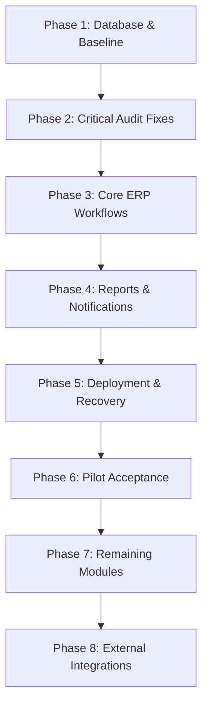

# EduNexus ERP — Completion Master Plan

## 1. Project Overview & Architectural Foundation
EduNexus ERP is an institutional management enterprise platform designed for schools, coaching institutions, and multi-branch academies. It operates with a strict multi-tenant architecture backed by PostgreSQL, an Express + TypeScript REST API backend, and a React 18 + Vite + TailwindCSS frontend within an npm workspace monorepo.

### Architectural Core
- **Monorepo Structure**: Root workspaces `frontend` and `backend`.
- **Database & Data Layer**: Isolated PostgreSQL instances with native SQL migrations, deterministic baseline schema, and Row Level Security (RLS) enforcement.
- **Backend**: Express + TypeScript (`backend/src/server.ts`), modular routes (`backend/src/routes/`), centralized error handling, and transactional SQL operations via `pg`.
- **Frontend**: React 18 SPA with Vite (`frontend/src/App.tsx`), RBAC permission guards (`frontend/src/services/auth/permissionPolicy.ts`), context-driven authentication (`TenantContext`, `AuthContext`), and modular feature blades.
- **Multi-Tenancy Guard**: Tenancy isolation enforced by `X-Tenant-ID` header, token claim verification, database foreign keys, and query filtering.

---

## 2. Phase Breakdown & Execution Sequence

| Phase | Title | Primary Goal |
|---|---|---|
| **Phase 1** | Database & Baseline | Establish reproducible local DB, verify 40 native migrations, seed deterministic test fixtures for two institutions, build workspaces, and run baseline suites. |
| **Phase 2** | Critical Audit Fixes | Resolve permission policy fall-through, student attendance policy reconciliation, base64 proof upload limits (5MB vs 2MB JSON), prototype routes, and server-side AI credentials. |
| **Phase 3** | Core ERP Workflows | Validate end-to-end multi-tenant lifecycle: student onboarding, teacher attendance, timetable collision detection, fee invoice & receipting, and examination grading. |
| **Phase 4** | Reports & Notifications | Replace demo export stubs with authoritative database aggregations (enrollment, attendance, financials, report cards) and verify async notification worker with delivery retry logic. |
| **Phase 5** | Deployment & Recovery | Production containerization/systemd supervision, CORS/TLS alignment, root CI pipelines, database backup and out-of-place restore verification. |
| **Phase 6** | Pilot Acceptance | Cross-role acceptance verification (Admin, Teacher, Accountant, Parent, Student), keyboard/mobile usability, concurrency validation, and final GO/NO-GO determination. |
| **Phase 7** | Remaining Modules | Complete unfinished feature blades: Homework & Submissions, CRM, Settings/Roles, Health, and remaining HR/Inventory/Transport/Hostel/Mess modules. |
| **Phase 8** | External Integrations | Hardened production integrations: Razorpay webhooks with idempotency, SMS/WhatsApp queues, private S3/MinIO signed URLs, and tenant-isolated server AI. |

---

## 3. Standard Operating Rules & Governance
1. **Current Code is Authoritative**: Audit notes are starting hypotheses. Never override existing fixes without reproducing against current mounted code.
2. **Preserve Ongoing Changes**: Always check git diffs before modifying files; do not discard work in progress.
3. **Deterministic Fixtures**: Use reproducible synthetic test institutions (Alpha Academy and Beta International) and deterministic seed credentials. Never connect tests to production databases.
4. **No Test Weakening**: Never relax assertions, remove authorization checks, or mock return values in core application paths to force test passes.
5. **Standard Status Vocabulary**:
   - `NOT_STARTED`
   - `IN_PROGRESS`
   - `IMPLEMENTED_UNVERIFIED`
   - `BLOCKED`
   - `DEFERRED`
   - `VERIFIED` (Only `VERIFIED` counts as complete).
